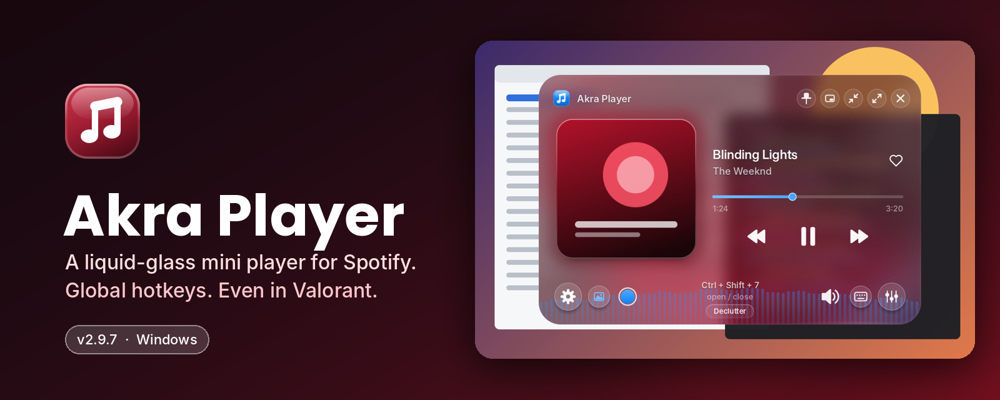
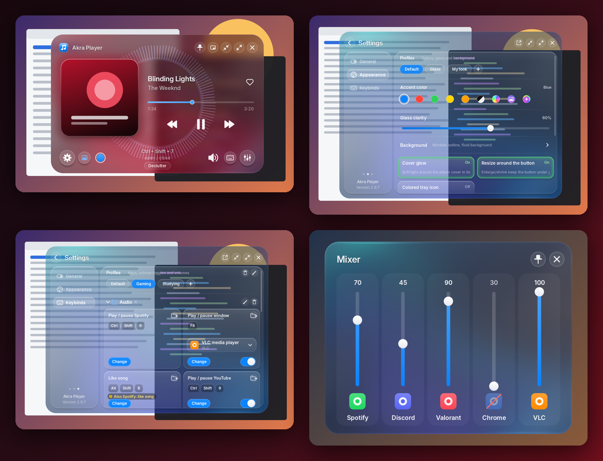

<div align="center">



<br>


**A liquid-glass mini player for Spotify, with global hotkeys that work even in games.**

[Download](#-install) · [Features](#-features) · [Hotkeys](#-hotkeys) · [YouTube extension](#-youtube-play--pause-extension) · [Build](#-build-from-source)

</div>

---

## ✨ Features

|   |   |
|---|---|
| 🪟 **Liquid glass UI** | A custom-drawn glass window with background blur, a fluid color background that follows your album cover, and an optional outline. |
| ⌨️ **Hotkeys that work in games** | Control music from anywhere, including Valorant. Popups show in borderless/windowed mode. |
| 🎚️ **Per-app mixer** | Every app playing sound gets its own volume slider. Click an icon to mute it. Pin it and it stays on screen even when the player is closed. |
| 🎵 **Visualizers** | Bars, Halo, Screen Edge (bars or waveform), Threads, Glow Line, Mesh, Ripples, Waveform and Sparks, each with sensitivity, smoothness and its own sliders. |
| 🎨 **Appearance profiles** | Built-in **Default** and **Glass** looks, plus your own. Accent colors, RGB shift, album-cover color, custom colors and three "switched-on" styles. |
| 😴 **Sleep timer** | 15 min, 30 min, 1 hour or end of song. Works with the player hidden. |
| 🔔 **Popups** | Key-press notes and "now playing" popups. Choose the screen and the corner. |
| 🌫️ **Fade when idle** | The player fades out when you aren't using it. Set the delay and the opacity. |
| 🧩 **Declutter** | One key hides everything but the essentials. Works globally or only inside the app. |
| 📤 **Export / import** | Save General, Appearance and Keybinds to an `Exported Profiles` folder and bring them back later. |
| 🌐 **YouTube play / pause** | A bundled browser extension lets one key pause YouTube from anywhere. |

<br>

<div align="center">

</div>

---

## 📥 Install

1. Download **AkraPlayer.zip** from the [Releases](../../releases) page and unzip it somewhere permanent (for example, your Desktop).
2. Run **AkraPlayer.exe**.
3. If Windows says *"Windows protected your PC"*, click **More info → Run anyway**. The app isn't code-signed.

Updating? Right-click the tray icon (bottom right, maybe under the `^` arrow) → **Quit**, then run the new exe. Your keys, profiles and settings carry over.

> **Note:** Windows only. It has no outside dependencies and is a single `.exe`.

---

## ⌨️ Hotkeys

Set them in **Settings → Keybinds**. Click **Change** on a card, then press the key.

| Action | What it does |
|---|---|
| Play / pause Spotify | Toggle playback |
| Play / pause YouTube | Pause or resume a video tab (needs the extension) |
| Play / pause window | Send play/pause to any app you pick (has an on/off switch) |
| Like song | Likes the current Spotify song |
| Mute current window | Mutes whatever app is in front |
| Volume Toggle | Switch between volume presets |
| Hold to lower music | Music drops while you hold the key (great with Discord push-to-talk) |
| Open Akra Player | Show or hide the player |
| Declutter | Hide or show the extras |

Keybinds are grouped in **folders** (Audio, Volume, Player) and **profiles** (for example "Gaming" and "Studying"). You can switch profiles in one click, or from the tray menu.

**While the player is in front:**
`Space` play/pause · `←` `→` previous/next · `↑` `↓` volume · `M` mute · `Esc` close or hide

---

## 🌐 YouTube play / pause extension

Works in **Chrome, Brave, Edge, Opera and Vivaldi**.

1. Open `chrome://extensions` (or `brave://`, `edge://`, and so on).
2. Turn on **Developer mode**.
3. Click **Load unpacked** and pick the [`browser-extension`](browser-extension) folder.
4. Open Akra Player once so it can link itself. The extension's popup should read **Linked to Akra Player ✓**.

The full walkthrough, with troubleshooting, is in [`browser-extension/HOW TO INSTALL.txt`](browser-extension/HOW%20TO%20INSTALL.txt).

---

## 🕹️ Using it

```
Drag the glass ............ move the player
Scroll down on it ......... open Settings
Click the song / cover .... jump to Spotify
Click the track length .... show time left
Hold enlarge (1.5 s) ...... fill the screen
Mini player ............... a small pill in the nearest corner
Pop-out (in Settings) ..... Settings in its own window
```

Full details live in [`README.txt`](README.txt), the plain-text guide that ships with the app.

---

## 🛠️ Build from source

Pure Go standard library, with raw Win32 calls. No cgo, so you can build it from Windows, Linux or macOS.

```bash
GOOS=windows GOARCH=amd64 CGO_ENABLED=0 \
  go build -trimpath -ldflags "-H windowsgui -s -w" -o AkraPlayer.exe .
```

On PowerShell:

```powershell
$env:CGO_ENABLED = "0"
go build -trimpath -ldflags "-H windowsgui -s -w" -o AkraPlayer.exe .
```

Requires Go 1.24 or newer.

**Previewing the UI without Windows.** The custom renderer also builds on Linux/macOS as an image-only preview tool:

```bash
go build -o akprev .
./akprev -preview out.png -size 520x340 -art -blur -fluid 2 -vis -visstyle 0
./akprev -preview settings.png -size 640x480 -page 1 -section 1
```

Run `./akprev -h` for every option.

### Project layout

| File(s) | What's in it |
|---|---|
| `canvas.go`, `glass.go`, `fluid.go`, `vis.go` | Software rasterizer, glass effect, fluid background and visualizers |
| `ui*.go`, `model.go` | The UI (player, settings, pop-outs, export/import) and its state |
| `main_windows.go`, `overlay_windows.go`, `popup_windows.go`, `setwin_windows.go` | Windows, overlays and pop-out windows |
| `hotkeys_windows.go`, `hook_windows.go`, `keys.go` | Global hotkeys and the keyboard hook |
| `spotify_windows.go`, `media_windows.go`, `audio_windows.go`, `mixer_windows.go` | Spotify, media controls and per-app volume |
| `config_windows.go`, `looks_windows.go` | Settings, keybind profiles, appearance profiles, export/import |
| `ext_windows.go`, `browser-extension/` | Native-messaging host and the browser extension |
| `preview_other.go` | The Linux/macOS preview tool |

---

## 🗂️ Where things are saved

| What | Where |
|---|---|
| Settings | `%APPDATA%\AkraPlayer\settings.txt` |
| Crash details | `%APPDATA%\AkraPlayer\crash.txt` |
| Exports | `Exported Profiles\` next to `AkraPlayer.exe`, named `Akra Player Export - <profile>` |

---

## 📝 Good to know

- **Games:** popups show in borderless or windowed mode. Exclusive-fullscreen games don't let anything draw over them.
- **Like song:** Spotify has no "like" API for apps, so Akra Player presses Spotify's own shortcut inside Spotify. From a hotkey it skips this while a fullscreen game is in front.
- **Screenshots:** to blur what's behind it, the glass hides for a split second during a screen grab. A screenshot taken in exactly that moment may miss the player.

---

## 🙏 Credits

Fonts: [Inter](https://rsms.me/inter/) (Rasmus Andersson) and [Poppins](https://github.com/itfoundry/poppins) (Indian Type Foundry), both under the SIL Open Font License 1.1. See [`fonts/`](fonts).

<div align="center">
<sub>Made by Akra · version 2.9.7</sub>
</div>
